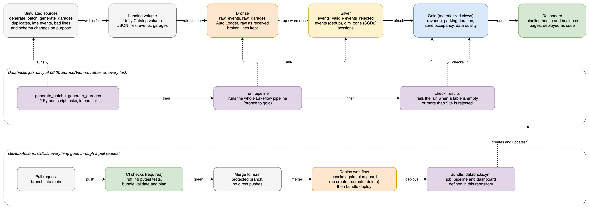

# Parking Lakehouse

[](https://github.com/nader-hachana/parking-lakehouse/actions/workflows/deploy.yml)

A data pipeline on Databricks that turns raw, messy parking garage events into clean, tested tables and a dashboard. Everything runs on a schedule, and the job, the pipeline and the dashboard are deployed from this repository by CI/CD.

I built it to learn Databricks hands-on, coming from PostgreSQL, ClickHouse and PySpark. I picked parking because I already know the domain, so I could focus on the platform instead of the business logic.

## Project status

| Phase | What | Status |
|---|---|---|
| 0 | Setup: workspace, CLI, catalog, schemas, landing volume | Done |
| 1 | Event generator | Done |
| 2 | Bronze with Auto Loader | Done |
| 3 | Silver with Lakeflow Declarative Pipelines | Done |
| 4 | Gold tables and performance | Done |
| 5 | Orchestration with Jobs | Done |
| 6 | Tests and CI/CD with bundles | Done |
| 7 | Observability and dashboard | Done |
| 8 | Documentation | In progress |

## Architecture



- **Sources (simulated):** two generators write JSON files into a volume. Events (entry, payment, exit) arrive in batches, zone attributes (capacity, hourly rate) arrive as daily snapshots.
- **Bronze:** the files as they arrived, loaded incrementally with Auto Loader. Nothing is cleaned, and broken lines are kept with their raw text.
- **Silver:** typed events that passed the quality rules (drop or warn), a quarantine table with the reason for every dropped record, one row per `event_id`, a zone dimension with history (SCD Type 2), and one row per parking session.
- **Gold:** revenue per garage and day, average parking duration, occupancy per zone and hour, and data quality per delivered file.
- **Delivery:** a Databricks job orchestrates generation, pipeline and a final data check. The job, the pipeline and the dashboard are one bundle, deployed by GitHub Actions after a merge.

The generated data is messy on purpose: duplicates (inside a file and across files), late events, missing fields, invalid values, broken lines, and two new fields that appear over time. That is what gives the cleaning steps something to do.

## Result of a full run

Six runs of the job from an empty workspace, repeated three times (by hand, through the CLI and through the bundle) with identical numbers:

| Layer | Result |
|---|---|
| Raw lines landed | 1,815 |
| Rejected (10 broken lines and 3 invalid amounts) | 13, each with its reason |
| Unique events in silver | 1,770 (duplicates removed) |
| Sessions | 600 |
| Zone history | 7 rows (one zone changed its rate on 2026-10-05, so it has two versions) |
| Gold revenue against silver payments | equal (6,720.1) |

## Key design decisions and trade-offs

| Decision | Why | Trade-off |
|---|---|---|
| One pipeline owns bronze, silver and gold | One declared graph, checkpoints and schema handling managed for me, and Free Edition allows one active pipeline anyway | Less control over internal state, a full reset means a full refresh |
| Bronze keeps raw data, including broken lines (`_corrupt_record`) | Nothing is lost silently, and a row count that matches the file lines would hide lost content (I found that on a real run) | Bronze holds junk, silver has to filter it |
| Quality rules in one dictionary, used for the expectations and the quarantine table | The rows dropped and the rows quarantined cannot drift apart, and the rules are testable | Only row level rules fit in it |
| Drop for corrupt JSON, missing id, unknown type, invalid amount. Warn for a missing plate or unknown vehicle type | Occupancy, duration and revenue do not need the plate, so a valid parking event is not thrown away for it | A warning keeps the row, so the warning count has to be watched |
| Deduplication with `AUTO CDC` (type 1) on `event_id`, latest ingestion wins | Retries and replayed files repeat the same id | Lineage in silver points to the latest delivery. If corrections should be ignored, the rule changes |
| Zone history with `AUTO CDC` (type 2), the sequence column left out of the tracked columns | A new version only when an attribute changes, and an old snapshot cannot overwrite a newer one | Depends on a reliable snapshot timestamp |
| Sessions and gold as materialized views | A late exit has to change a session that was already counted | A refresh can cost a full recompute. One view (occupancy) is always recomputed, which the engine's cost model judged cheaper at this size |
| Schema evolution `addNewColumns` in bronze, explicit column list in silver | A new field lands in bronze without breaking anything, and does not reach silver by accident | One line to add per field silver should use |
| Generator state lives in the volume and is committed after the output file is written | Job compute is temporary, and a failed or retried run must not damage the series | A crash between the file and the state loses the late events held by that attempt |
| Liquid clustering on `(garage_id, zone_id)` (measured on a 150,000 event copy) | Files read 10 to 1 and bytes read about 10 times fewer for a one zone query, same answer | At this size it shows the mechanism, not production speed, and the time gain was modest |
| Python for the pipeline, SQL for analysis | Same engine, so I chose by maintainability: shared rules and testable functions | |
| A deploy guard that refuses to create, recreate or delete resources | A runner that does not recognise an existing resource would duplicate it, and a recreate of the pipeline deletes its tables | A new resource has to be bound and deployed once by hand |
| Personal access token for the deploy | Free Edition allows creating one | Tied to a person and expires after 30 days. A service principal with OAuth would be the production choice |

## How it runs

```
generate_batch  ----\
                      >----  run_pipeline  ---->  check_results
generate_garages ---/
```

- **generate_batch** (`generator/run_batch.py`) writes the next batch of events. It works out the batch number and date itself and keeps its state in the volume.
- **generate_garages** (`generator/run_garages.py`) writes the next daily snapshot of the zones, including a scheduled rate change.
- **run_pipeline** ingests the new files and refreshes bronze, silver and gold.
- **check_results** (`checks/check_results.py`) fails the run when the numbers are clearly wrong, for example an empty table or more than 5 % of raw lines rejected.

The job has a daily schedule at 06:00 Vienna time, paused by default.

## Setup and deployment

One-time, in a Databricks workspace (the SQL editor):

```sql
CREATE CATALOG IF NOT EXISTS parking;
CREATE SCHEMA IF NOT EXISTS parking.landing;
CREATE SCHEMA IF NOT EXISTS parking.bronze;
CREATE SCHEMA IF NOT EXISTS parking.silver;
CREATE SCHEMA IF NOT EXISTS parking.gold;
CREATE VOLUME IF NOT EXISTS parking.landing.events;
```

Then, with the [Databricks CLI](https://docs.databricks.com/aws/en/dev-tools/cli/) authenticated (`databricks auth login --host <workspace url> --profile parking`):

```bash
databricks bundle validate --profile parking
databricks bundle deploy --profile parking
databricks bundle run parking_daily --profile parking
```

`deploy` uploads the code and creates or updates the job, the pipeline and the dashboard. Run the last command once per batch to follow the data through the layers, or switch the schedule on with `--var schedule_pause_status=UNPAUSED`. To start over, empty the landing folders in the volume and deploy a fresh bundle (after `databricks bundle destroy`, and drop the pipeline's tables, which are not always removed with it).

The generators also run on their own with [uv](https://docs.astral.sh/uv/):

```bash
uv run python generator/run_batch.py --root data/local/landing --sessions 100
uv run python generator/run_garages.py --root data/local/landing --set-rate-from 2026-10-05:G01:Z1=2.75
```

## Observability

- **Pipeline health query** (`queries/pipeline_health.sql`): "how many bad records did we drop yesterday, and is today's data fresh?". Dropped records come from `gold.data_quality_by_batch` (one row per delivered file: lines, rejected rows by reason, rows kept with a missing plate), freshness from the newest `_ingested_at` in bronze (stale after 26 hours, because a daily run is expected). Freshness uses the arrival time: the generated events carry dates that follow the batch number, not the clock.
- **Dashboard** (`dashboards/parking_dashboard.lvdash.json`, deployed by the bundle): a page for pipeline health (hours since the last ingestion, freshness status, records dropped yesterday, reject share of the last delivery, rejected rows by reason per batch) and a page for the business (revenue and average parking duration per garage and day, occupancy by hour with garage and zone filters, sessions by status). The datasets are in `queries/dashboard_datasets.sql`, and the SQL warehouse is found by name at deploy time.

## Tests

```bash
uv run pytest
uv run ruff check .
```

- **Generator (plain Python):** the data it produces (every session has entry, payment and exit in order, unique event ids), each injected problem (rates, no event with two problems, exact duplicates, late events keeping their time, cut-off JSON lines), the two schema changes, the batch and snapshot runners, and the state handling (a failed write leaves the state untouched).
- **Pipeline:** the real pipeline file is imported with a fake `pyspark.pipelines` that records what it declares, so the tests check the design (the tables and views, the keys and sequence columns of both CDC flows, that `snapshot_ts` is not tracked, that the shared rule dictionary is used as drop and warn rules). The SQL rules and the data quality logic are evaluated on sample rows with a small local Spark session (PySpark 3.5, needs Java 11 to 17, skipped without Java).

## CI/CD

- **On every pull request:** `ruff` and `pytest` (`ci.yml`), and `bundle validate` plus `bundle plan` (`validate.yml`, only for branches of this repository, because forks get no secrets), so a broken bundle is caught before the merge and the pull request shows what a merge would change.
- **After a merge to `main`** (`deploy.yml`): the same checks run first, then `bundle validate`, a `bundle plan` that stops if it would create, recreate or delete anything instead of updating the existing resources, and `bundle deploy`. It does not run the job, and the schedule stays paused.
- **`main` is protected** by a ruleset: changes go through a pull request with `lint-and-test` and `validate-bundle` green and the branch up to date. Direct pushes are rejected, for the owner too, and the owner can only bypass through a pull request.
- **Credentials:** `DATABRICKS_HOST` and `DATABRICKS_TOKEN` are GitHub Actions secrets. The token is a personal access token with a 30 day lifetime, so the deploy will fail with an authentication error when it expires: create a new one and run `gh secret set DATABRICKS_TOKEN`.

## Repository layout

```
generator/        simulates the source systems (events and zone snapshots)
pipelines/        the Lakeflow Declarative Pipeline: bronze, silver and gold
checks/           data checks run as the last task of the job
queries/          saved SQL: the pipeline health query and the dashboard datasets
dashboards/       the dashboard definition (AI/BI dashboard as a .lvdash.json file)
resources/        the job, the pipeline and the dashboard as bundle resources
databricks.yml    the bundle: what gets deployed and how
architecture.drawio / .png   the architecture diagram (source and export)
tests/            unit tests for the generator and the pipeline design
.github/          the CI, bundle validation and deploy workflows
```

## Limitations and what I would do next

- **Free Edition:** small data volumes, serverless compute only and capped (running notebooks or queries during a job run can trigger a "limit for serverless compute" error, which the pipeline retries by itself), one active pipeline, managed storage only, one workspace (so a single `dev` target).
- **Simulated data:** event dates follow the batch number, not the clock, so freshness is measured on arrival time. Occupancy only counts complete sessions, so it is understated until a late exit arrives.
- **Volumes cannot append to an existing file**, so the generator rewrites its state files as whole files.
- **No alerts yet:** the dashboard shows freshness and the reject share, but nothing notifies anyone. The first thing I would add is a freshness alert, because a paused or deleted job fails silently.
- **The end to end result is checked by hand** (the six run series). I would automate it as a nightly run on a dev target.
- **Deploy hardening:** a service principal with OAuth instead of a token, a `prod` target in a second workspace, and pinned versions for the Databricks CLI action.
